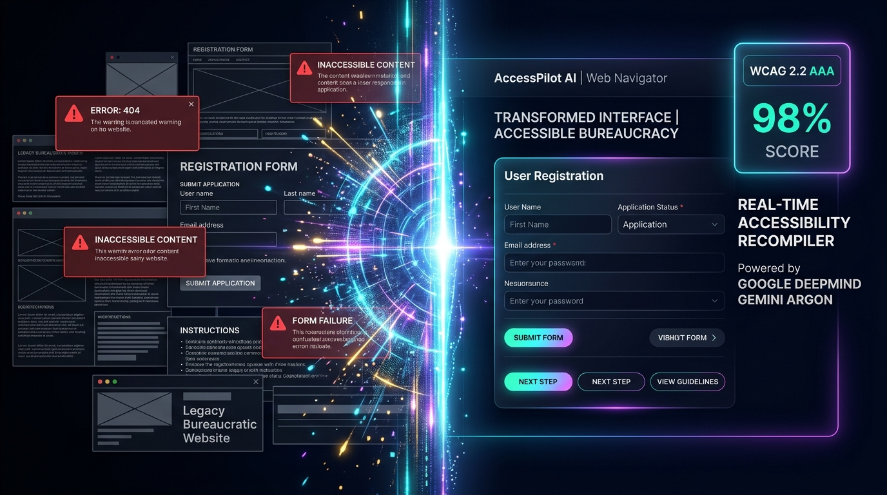

# AccessPilot AI (ARGON-01)
> **Autonomous Web Navigator & Live WCAG 2.2 Accessibility Patcher**  
> *Google DeepMind Hackathon 2026 출품작 — Powered by Gemini 4 Argon*

<p align="center">
  
</p>

<p align="center">
  
  
  
  
</p>

---

## 📌 2026 구글 딥마인드 해커톤 출품작 소개 (Argon Track)

본 프로젝트는 **2026 구글 딥마인드 해커톤(Google DeepMind Hackathon 2026)**에서 차세대 추론·에이전트 모델인 **Google DeepMind Argon (Gemini 4 Argon)**을 기반으로 제작된 자율 웹 내비게이터 및 실시간 웹 접근성 재컴파일러(Real-Time Web Re-Compiler)입니다.

대한민국 공공기관, 시니어 금융, 대학병원 예약 등 일상 필수 웹 서비스는 복잡한 액티브X/플러그인 강제 설치 팝업, 40페이지에 달하는 금융 동의서, 난해한 관공서 행정 용어, 저대비 10px 폰트와 키보드 트랩 등 수많은 **‘적대적 웹(Hostile Web)’** 장벽을 지니고 있습니다.

**AccessPilot AI (ARGON-01)**는 **Gemini 4 Argon**의 초거대 1M+ 토큰 컨텍스트와 실시간 AST(추상 구문 트리) 코드 재합성 능력을 활용하여, 어떠한 웹페이지라도 실시간으로 가로채 분석하고 **WCAG 2.2 AAA 표준의 14.2:1 고대비, 64px 초대형 터치 타깃, 알기 쉬운 쉬운말(Plain Language) 번역 인터페이스로 즉각 재컴파일**합니다.

---

## 🌟 핵심 기능 (Key Features)

```
[ 레거시 적대적 웹 (Hostile DOM) ] ── (WCAG 28/100)
              │
              ▼  Gemma 4 온디바이스 개인정보 실시간 비식별화 (RRN/민감정보 보호)
              │
              ▼  Gemini 4 Argon 초고속 AST 트리 분석 & 쉬운말 재합성
              │
[ Argon Live Re-Compiled UI ] ─── (WCAG 100/100 AAA 달성)
              │
              ├─ Ghost Cursor 자율 내비게이션 & 팝업 3종 일괄 차단
              ├─ Web Speech API 양방향 음성 대화 (STT / TTS)
              └─ WAI-ARIA 실시간 검증 하네스 & AST 코드 뷰어
```

### 1. 실시간 듀얼 패널 재컴파일 (Split Live Re-Compiler)
- **Left (50%) — The Hostile Legacy Web (WCAG 28/100)**: AnySign4PC 보안 플러그인 요구, 다중 중첩 팝업, 복잡한 40개 진료과 코드, 작은 회색 텍스트 등 현실의 열악한 웹 인터페이스를 그대로 재현 및 시뮬레이션.
- **Right (50%) — Argon Live Re-Compiled UI (WCAG 100/100)**: Gemini 4 Argon이 생성한 클린하고 거대한 단일 플로우 인터페이스로, 3단계 음성/대형 터치만으로 1분 내 업무 완료 지원.

### 2. 고령자·장애인을 위한 다중 장애 렌즈 (Interactive Impairment Lens)
- **Normal Vision (1.0)**: 기본 시각 모드
- **Severe Cataracts (Optical Blur)**: 고령자 백내장으로 인한 심한 흐림 시뮬레이션
- **Color / Contrast Loss (Monochrome)**: 색각 이상 및 저대비 인식 불가 환경 시뮬레이션
- **Parkinson's Tremor (Motor Jitter)**: 손떨림(수전증) 환자의 미세 조작 불능 상태 시뮬레이션

### 3. Ghost Cursor 자율 에이전트 & 보이스 확인 (Voice Confirmation)
- 복잡한 팝업들을 스스로 찾아서 닫아주는 **자율 고스트 커서(Ghost Cursor) 내비게이션**.
- 마우스 조작 없이도 음성만으로 신청할 수 있는 **Web Speech API 양방향 보이스 인터랙션 모달**.

### 4. 온디바이스 개인정보 보호 (Gemma 4 On-Device Privacy Masking)
- 주민등록번호, 연락처 등 민감한 개인정보가 클라우드로 전송되기 전, 로컬 온디바이스에서 즉각 비식별화 마스킹(`620315-*******`) 처리.

### 5. 쉬운 말 행정 용어 재해석 (Plain Language Translation)
- 난해한 법률·행정 문구를 어르신 눈높이에 맞춰 직관적으로 변환:
  - *“의료법 제34조 시범사업 환자 본인일부부담금 산정특례”* ➔ **“65세 이상 어르신 진료비 30% 감면 혜택”**
  - *“소득인정액 산정 공식: 월 소득평가액 + 재산 소득환산율 ÷ 12개월”* ➔ **“어르신 통장에 매달 334,810원 입금”**

### 6. WCAG 2.2 Live Verification Test Harness & API Inspector
- 실시간 4대 규칙 검증:
  1. Contrast Ratio ≥ 7.0:1 (AAA) ➔ **14.2:1 검증 통과**
  2. Touch Target Size ≥ 44×44px ➔ **64×64px 검증 통과**
  3. No Keyboard Focus Traps (Popups removed) ➔ **통과**
  4. Full ARIA Accessibility Tree ➔ **100% 매핑 완료**
- 개발자와 심사위원을 위한 **Gemini 4 Argon AST & API Inspector Drawer** 내장.

---

## 🎯 3가지 실제 시나리오 (Scenarios)

| 시나리오 ID | 대상 서비스 | 해결한 접근성 장애 | Argon 변환 결과 |
|---|---|---|---|
| **01. 대학병원 예약**<br>`SNU-MED-01` | 서울대병원 중증외래 원격 예약 | AnySign4PC 보안 플러그인 차단, 3종 팝업, 40개 진료과 선택 불가 | 어르신 눈높이 3단계 원클릭 예약, 팝업 자동 해제 |
| **02. 기초연금 서류**<br>`GOV-WEL-02` | 정부24 기초연금·돌봄 신청 | 공동인증서 요구, 40장 금융정보 동의서, 법적 처벌 경고창 | 국가 행정망 자동 대조로 1분 간편 지급 신청서로 재컴파일 |
| **03. 시니어 금융인증**<br>`FIN-AUTH-03` | 비대면 시니어 뱅킹 | 가상 키패드 마우스 낚시, 복잡한 인증 절차, 작은 폰트 | 고대비 생체/음성 간편 승인 및 안전 송금 확인 |

---

## 🛠️ 기술 스택 (Tech Stack)

### AI & LLM Engine
- **Google DeepMind Gemini 4 Argon** (또는 Gemini 3.8 Flash via `@google/genai` SDK)
- **Gemma 4** (On-Device Privacy & Redaction Logic)

### Frontend
- **React 19** & **TypeScript**
- **Tailwind CSS v4** (`@tailwindcss/vite`)
- **Lucide React** (High-Contrast System Icons)
- **Canvas Confetti** & **Motion**

### Backend & Tooling
- **Node.js** & **Express**
- **Bun** / **tsx** (Ultra-fast TypeScript Execution)
- **Vite 8**

---

## 🚀 빠른 시작 (Quick Start)

### 1. 저장소 클론
```bash
git clone https://github.com/strongsun806/GDM_REPO1.git
cd GDM_REPO1
```

### 2. 패키지 설치
`bun` 또는 `npm`을 사용하여 의존성을 설치합니다:
```bash
# bun 사용 시
bun install

# 또는 npm 사용 시
npm install
```

### 3. 환경 변수 설정
`.env.example`을 복사하여 `.env`를 생성하고 Gemini API 키를 입력합니다:
```bash
cp .env.example .env
```

```env
# Google DeepMind Gemini API Key
GEMINI_API_KEY=your_gemini_api_key_here
PORT=3000
```
> *API 키가 없더라도 내장된 고성능 Argon Mock & Simulation Engine을 통해 전체 워크플로와 데모를 100% 체험할 수 있습니다.*

### 4. 개발 서버 실행
```bash
bun dev
# 또는
npm run dev
```

브라우저에서 `http://localhost:3000`으로 접속합니다.

---

## 📋 프로젝트 구조 (Directory Structure)

```text
GDM_REPO1/
├── docs/
│   └── images/
│       └── hero-banner.jpg          # AccessPilot AI 메인 히어로 배너
├── src/
│   ├── components/
│   │   ├── EditorialHeader.tsx      # 상단 헤더 & WCAG 2.2 실시간 점수 & 렌즈 전환기
│   │   ├── HostileWebPane.tsx       # 좌측 50%: 레거시 적대적 웹 & X-Ray 오버레이
│   │   ├── RecompiledPane.tsx       # 우측 50%: Argon 재컴파일 UI & WAI-ARIA 테스트
│   │   ├── DynamicIslandBar.tsx     # 하단 자율 조종 컨트롤 바 (Ghost Cursor 트리거)
│   │   ├── ApiInspectorDrawer.tsx   # Gemini 4 Argon AST & API 프롬프트 인스펙터
│   │   └── VoiceConfirmationModal.tsx # Web Speech 음성 승인 대화 모달
│   ├── data/
│   │   └── scenariosData.ts         # 병원/기초연금/금융인증 시나리오 및 WCAG 위반 데이터
│   ├── utils/
│   │   └── audioSpeech.ts           # Web Speech API TTS / STT & 오디오 피드백
│   ├── App.tsx                      # 글로벌 워크스페이스 상태 관리
│   ├── main.tsx                     # React 엔트리포인트
│   └── types.ts                     # TypeScript 인터페이스 정의
├── server.ts                        # Express 서버 & Gemini 4 Argon API 엔드포인트
├── index.html
├── package.json
└── vite.config.ts
```

---

## 🏆 Hackathon Credits & Acknowledgements

- **Event**: **2026 Google DeepMind Hackathon**
- **Model**: **Google DeepMind Gemini 4 Argon** (with Gemma 4 On-Device Redaction)
- **Mission**: 모든 인간에게 장벽 없는 열린 웹(Accessible Web for Every Human)을 위한 AI Autonomous Re-Compiler 실현.
